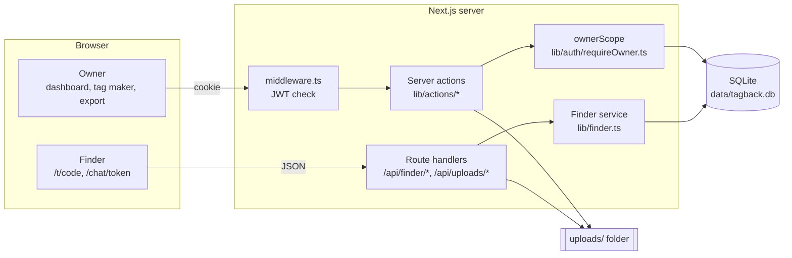
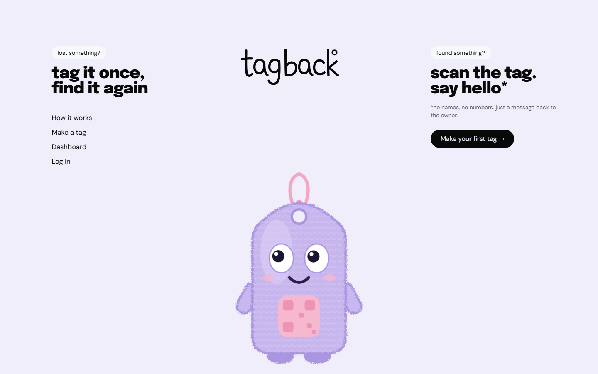
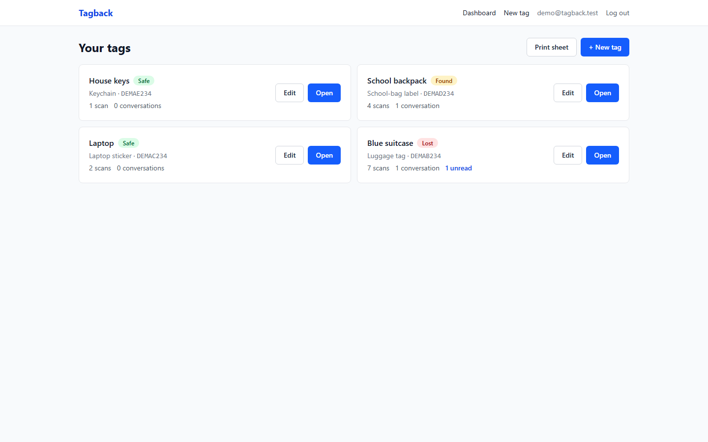
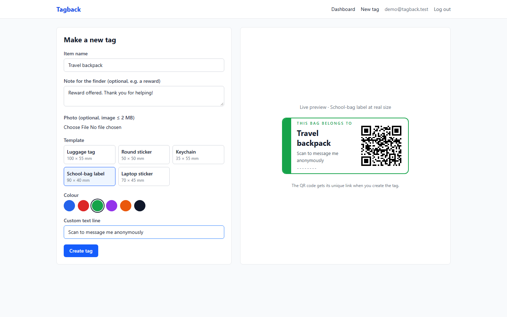
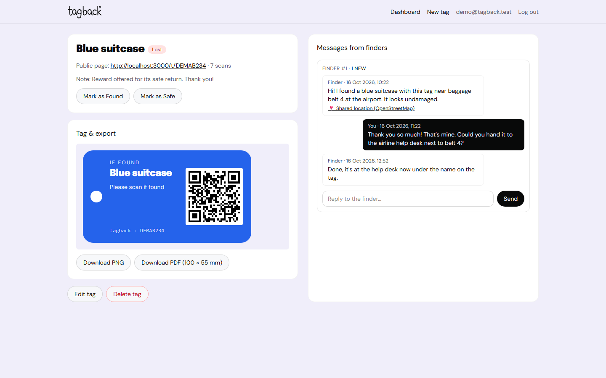
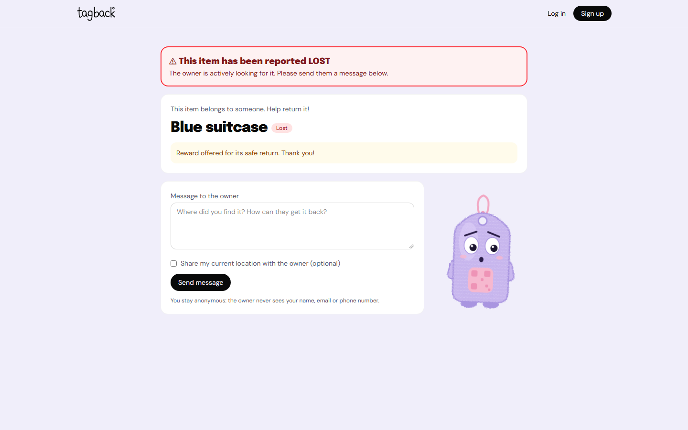

# Tagback

**Privacy-preserving QR bag tags: anyone who finds your things can message you, and neither of you has to reveal who you are.**

> Built with [Claude Code](https://claude.com/claude-code) (AI-assisted development). Runs entirely on `localhost` with a local SQLite database: no external accounts or cloud services needed.

---

## Problem Statement

Lost luggage, school bags, laptops and keys are often found by honest people who have no way to contact the owner. Writing a phone number or email on a tag exposes personal data to anyone who sees it, which invites spam and fraud and is unsafe for children. Existing "smart tag" products depend on proprietary hardware or reveal the owner's contact details once scanned. There is a need for a free, simple tag that connects a finder with an owner **without revealing either person's identity**.

## Objectives

1. Let owners design and print QR tags for their belongings in several real-world formats (luggage tag, stickers, keychain, labels).
2. Give finders a public page, opened by scanning the QR, where they can message the owner anonymously and optionally share their location.
3. Relay the conversation in both directions so that the owner's email and phone and the finder's identity are never exposed.
4. Protect the system with server-side access control, input validation, rate limiting, hashed secrets and spam protection.
5. Verify the system with automated unit and end-to-end tests.

## Features

| Area | What it does |
|---|---|
| Auth | Email + password sign-up / login / logout (bcrypt hashes, signed httpOnly JWT cookie). Middleware protects `/dashboard` and `/tags/*`. |
| Dashboard | Lists your tags with status badge (Safe / Lost / Found), scan count, conversation count and unread-message count. |
| Tag maker | Item name, optional photo (≤ 2 MB, checked by magic bytes), optional reward note, 5 templates, 6 colours, custom text line, **live real-scale preview** with the QR built in. |
| Export | Download a tag as **PNG** (3× pixel ratio, ~305 DPI) or as a **print-ready PDF** at the template's real size in mm. |
| Print sheet | Choose several tags and download a single **A4 PDF** with them laid out at real size with cut lines. |
| Manage tag | Edit, change status (Safe → Lost → Found…), delete, read conversations and reply. |
| Public finder page `/t/[code]` | "This item belongs to someone. Help return it!", a prominent banner when the item is reported **Lost**, message form with **opt-in location**, friendly 404 for unknown codes. |
| Finder chat `/chat/[token]` | The finder's private link for reading the owner's replies and sending more messages. |
| Scan counter | Each view of the public page increments the tag's scan count. |
| Landing page | Playful one-viewport "creative studio" layout (pale lavender canvas, Epilogue 900 headlines, DM Sans body) with real navigation links and a "How it works" strip. |
| Tagby mascot | Original plush luggage-tag mascot in pure SVG + CSS. Pupils follow the pointer, it bobs, blinks and looks around when idle, and its mood follows the tag status (Safe → happy, Lost → worried, Found → celebrating; celebrates for 2 s after a finder sends a message). Also shown on the empty dashboard and the unknown-code 404. Respects `prefers-reduced-motion`. |

Templates and their print sizes:

| Template | Size (mm) | QR size (mm) |
|---|---|---|
| Luggage tag | 100 × 55 | 34 |
| Round sticker | 50 × 50 | 25 |
| Keychain | 35 × 55 | 27 |
| School-bag label | 90 × 40 | 32 |
| Laptop sticker | 70 × 45 | 30 |

## Tech Stack

| Technology | Purpose |
|---|---|
| Next.js 15 (App Router) + React 19 | Full-stack framework: pages, server actions, route handlers, middleware |
| TypeScript | Static typing across client and server |
| Tailwind CSS 4 | Utility-first styling; design tokens live in `app/tokens.css` |
| Fontsource (Epilogue 900, DM Sans 400) | Self-hosted fonts, no external font URLs |
| SQLite via `better-sqlite3` | Local relational database (`./data/tagback.db`), foreign keys and indexes |
| `bcryptjs` | Password hashing |
| `jose` | Signing and verifying the session JWT (HS256) |
| `zod` | Validation of every form and API input |
| `nanoid` | Tag codes (custom unambiguous alphabet) and finder tokens |
| `qrcode` | QR code generation |
| `html-to-image` | Rendering a tag's DOM node to PNG |
| `jspdf` | Real-size PDF and A4 print-sheet export |
| Vitest | Unit tests for pure logic and data-access rules |
| Playwright (Chromium) | End-to-end smoke test and automated screenshots |
| Claude Code (Anthropic) | AI-assisted development |

## Architecture



Owners talk to the server through **server actions**; every owner query runs through `ownerScope(userId)`. Finders never authenticate. They use **route handlers** that only ever read or return public fields.

## Database Schema

Created automatically on first start (`lib/db/index.ts`, every statement `create … if not exists`). `npm run db:reset` deletes and recreates it.

| Table | Columns | Notes |
|---|---|---|
| `users` | `id` PK, `email` UNIQUE (nocase), `password_hash`, `created_at` | bcrypt hash, cost 12 |
| `tags` | `id` PK, `owner_id` → users (cascade), `code` UNIQUE (8 chars), `item_name` (1–60), `photo_path`, `note` (≤ 200), `design` JSON, `status` ∈ safe/lost/found, `scan_count`, `created_at` | index `(owner_id, created_at)` |
| `conversations` | `id` PK, `tag_id` → tags (cascade), `finder_token_hash` UNIQUE, `owner_last_read_at`, `created_at` | only the SHA-256 of the finder token is stored |
| `messages` | `id` PK, `conversation_id` → conversations (cascade), `sender` ∈ finder/owner, `body` (1–1000), `lat`, `lng`, `created_at` | index `(conversation_id, created_at)` |

CHECK constraints repeat the zod limits so the database itself rejects invalid data.

## Privacy Model

- **The finder never sees the owner.** The public page is built from a `PublicTag` type: item name, photo, note, status and code. No owner id, email or phone is selected from the database (`lib/finder.ts`).
- **The owner never sees the finder.** No account, name, email or IP address is stored for a finder. The owner sees only "Finder #1", the message text and, if the finder opted in, a location link to OpenStreetMap.
- **Token link.** On the first message the server generates a 32-character random token (`nanoid`, ~190 bits), stores **only its SHA-256 hash** in `conversations.finder_token_hash`, and returns the private link `/chat/<token>` once. That link is the finder's only way back. A leaked database cannot be used to open a conversation. A unit test checks that the raw token appears nowhere in the database file.
- **No token leaks.** `Referrer-Policy: no-referrer` is set globally and chat pages are `noindex`.
- **Access control (replaces database RLS).** All owner queries live in `ownerScope(ownerId)` (`lib/auth/requireOwner.ts`). Tags are filtered by `owner_id = ?`, and conversations and messages are reached only through a join on a tag the owner owns. A unit test proves that user B cannot read, reply to, re-status or delete user A's data.
- **Abuse protection.** zod validation on every input, a hidden honeypot field, a rate limit of 5 finder messages per 10 minutes per IP + tag (in memory; production would use Redis/Upstash), magic-byte checks on uploads, random upload names and strict name validation when serving files.
- **Sessions.** HS256 JWT in an `httpOnly`, `SameSite=Lax` cookie (Secure when served over HTTPS), signed with an auto-generated `SESSION_SECRET`. Login compares against a dummy bcrypt hash when the email is unknown, so response time does not reveal which emails are registered. `?next=` redirects are restricted to same-site paths.

## API Routes

| Method | Route | Who | Purpose |
|---|---|---|---|
| POST | `/api/finder/messages` | Anonymous finder | First message `{code, body, website, lat?, lng?}` → `201 {chatPath}`; 400 invalid/honeypot, 404 unknown code, 429 rate-limited |
| POST | `/api/finder/reply` | Finder with token | Follow-up message `{token, body, website}` → `201`; 404 bad token, 429 rate-limited |
| GET | `/api/uploads/[name]` | Anyone | Serves a tag photo (random name, validated, `nosniff`) |
| Server actions | `signup`, `login`, `logout` | Visitor / owner | `lib/actions/auth.ts` |
| Server actions | `saveTag`, `changeStatus`, `removeTag`, `replyAsOwner` | Signed-in owner | `lib/actions/tags.ts`, all through `requireOwner()` |

Pages: `/`, `/login`, `/signup`, `/dashboard`, `/tags/new`, `/tags/[id]`, `/tags/[id]/edit`, `/tags/print`, `/t/[code]`, `/chat/[token]`.

## Project Structure

```
app/                     routes only (thin pages); tokens.css = design tokens
  page.tsx               landing page (no shared header)
  (app)/                 route group with the shared header; URLs unchanged
  api/finder/messages/   first finder message (route handler)
  api/finder/reply/      follow-up finder message
  api/uploads/[name]/    serves tag photos
  chat/[token]/          finder's private chat
  dashboard/  login/  signup/
  t/[code]/              public finder page (+ not-found)
  tags/new/  tags/[id]/  tags/[id]/edit/  tags/print/
components/              UI components (Tailwind)
  landing/               Landing page
  mascot/                Tagby.tsx (+ tagby.css animations)
  brand/                 Wordmark (hand-drawn SVG; also public/logo.svg favicon)
  templates/             LuggageTag, RoundSticker, Keychain, SchoolLabel, LaptopSticker, Qr
  forms/                 AuthForm, TagForm, StatusForm, DeleteTagForm, OwnerReplyForm, FinderMessageForm, FinderReplyForm
  TagPreview, TagExportPanel, PrintSheet, MessageThread, StatusBadge, DashboardView, TagManageView, PublicTagView, FinderChatView
lib/
  db/                    SQLite connection + schema, row mappers
  auth/                  jwt.ts (edge-safe), session.ts, requireOwner.ts (access control)
  actions/               server actions (auth, tags)
  finder.ts              everything a finder can do (public fields only)
  eyeTracking.ts         pupil maths for Tagby (vector → clamp → lerp)
  codes.ts tokens.ts rateLimit.ts validation.ts status.ts templates.ts exportTag.ts uploads.ts imageType.ts http.ts
middleware.ts            protects /dashboard and /tags/*
scripts/                 env bootstrap, seed, db-reset, screenshots
tests/unit/              Vitest
tests/e2e/               Playwright smoke test
docs/screenshots/        generated screenshots
report/                  AAT-1 report generator (build-report.cjs, cover.cjs = college cover sheet) and .docx
```

## Setup

Requirements: Node.js 20+ (tested on Node 24, Windows 11).

```bash
npm install
npm run seed   # creates .env.local (SESSION_SECRET), the database and the demo account
npm run dev    # http://localhost:3000
```

- `.env.local` is created automatically with a random `SESSION_SECRET` and `NEXT_PUBLIC_SITE_URL=http://localhost:3000`. See `.env.example`.
- Demo login: `demo@tagback.test`. The password is random and stored in `.env.local` as `DEMO_PASSWORD`.
- To scan printed QR codes with a phone on the same Wi-Fi, set `NEXT_PUBLIC_SITE_URL=http://<your-LAN-IP>:3000` and run `npm run dev -- -H 0.0.0.0`.
- `npm run db:reset` wipes the local database.

| Script | Does |
|---|---|
| `dev` / `build` / `start` | Next.js (each first ensures `.env.local` exists) |
| `lint` | ESLint (next/core-web-vitals + TypeScript) |
| `test` | Vitest unit tests |
| `test:e2e` | Builds, seeds, and runs the Playwright smoke test |
| `seed` | Idempotent demo data |
| `db:reset` | Recreate the SQLite database |
| `screenshots` | Build, start on a free port, seed, capture `docs/screenshots/*`, stop |
| `screenshot:github` | Capture the public GitHub repo page to `docs/screenshots/github-repo.png` |
| `report` | Rebuild `report/AAT1_Report.docx` from the code, screenshots and git history |

## Testing

```bash
npm test          # 30 unit tests
npm run test:e2e  # end-to-end smoke test (Chromium)
```

- **Unit (Vitest):** code generation (length, alphabet, 10,000 unique codes), token hashing (raw token never stored, checked against the database file), zod schemas (message length, honeypot, note length, coordinates), rate limiter, status transitions, owner access control on a temporary database, and Tagby's eye-tracking maths.
- **End-to-end (Playwright):** the seeded user logs in and creates a tag, then downloads the PDF (checks the `%PDF` header). An anonymous browser context opens `/t/[code]` and sends a message. The owner sees it and replies, and the finder's private chat shows the reply. The test also asserts the owner's email never appears on finder pages.

## Screenshots

| | |
|---|---|
| Landing (desktop, pointer top-left) | `docs/screenshots/landing-desktop.png` |
| Landing (mobile) | `docs/screenshots/landing-mobile.png` |
| Login | `docs/screenshots/login.png` |
| Dashboard | `docs/screenshots/dashboard.png` |
| Tag maker | `docs/screenshots/tag-maker.png` |
| Exported PNG | `docs/screenshots/tag-export.png` |
| Finder page | `docs/screenshots/finder-page.png` |
| Finder page (Lost) | `docs/screenshots/finder-lost.png` |
| Tagby worried (Lost) | `docs/screenshots/finder-lost-tagby.png` |
| Tagby celebrating (Found) | `docs/screenshots/finder-found-tagby.png` |
| Owner chat | `docs/screenshots/owner-chat.png` |
| Finder page, mobile (390×844) | `docs/screenshots/finder-mobile.png` |
| Print sheet | `docs/screenshots/print-sheet.png` |
| GitHub repository | `docs/screenshots/github-repo.png` (after the first push: `npm run screenshot:github`) |







## Design Decisions

- **Local-first.** SQLite (`better-sqlite3`) and a local `uploads/` folder, so the project runs with `npm install` and no accounts. `better-sqlite3` installed cleanly on Windows / Node 24, so the `node:sqlite` fallback was not needed.
- **Access control in one place instead of RLS.** Without Postgres RLS, all owner data access is concentrated in `ownerScope()`. Pages and actions never write SQL, so ownership checks cannot be forgotten.
- **Separate surfaces for owners and finders.** Owners use server actions behind a session. Finders use JSON route handlers that only touch `lib/finder.ts`, which selects public columns only.
- **Hash-only finder tokens.** The same pattern as password-reset tokens: the secret lives only in the finder's link.
- **Real-scale rendering.** Templates are drawn at 4 px/mm, so the on-screen preview, PNG (3×) and PDF (exact mm page) all come from the same DOM and match physical size.
- **QR always black on white with a quiet zone**, whatever the tag colour, and never smaller than 25 mm, for reliable scanning.
- **Codes use an unambiguous alphabet** (`23456789ABCDEFGHJKMNPQRSTUVWXYZ`, no 0/O/1/I/L), so a code can be typed in from a worn tag.
- **Status transitions are explicit** (`safe → lost → found → safe`, plus cancel and re-report) and enforced on the server.
- **In-memory rate limiting** is enough for a single local process. It sits behind a small interface so it can be swapped for Redis or Upstash.
- **Thin pages.** Route files only load data and render one component. UI lives in small Tailwind components (shared class strings in `components/ui.ts`) for the planned redesign.
- **Landing page in its own layout.** The app pages moved into an `(app)` route group that holds the shared header, so the landing page can use the full viewport; no URL changed.
- **Tagby without animation libraries.** Pure SVG with CSS keyframes for bob/blink/wobble/confetti, an SVG filter (feTurbulence + feDisplacementMap) for the knitted edge plus a low-opacity grain overlay. The pupil maths (`lib/eyeTracking.ts`) is pure and unit-tested.
- **Animation loop only while needed.** The requestAnimationFrame loop starts on pointer movement or an idle glance and stops as soon as the pupils reach their target.
- **Middleware on the Node.js runtime.** This uses the same `jose` build and environment as the rest of the server and avoids Edge-runtime warnings.

## Challenges

- **TypeScript 6 rejected `import "./globals.css"`** (side-effect imports of unknown modules are now errors). Fixed with a `types/css.d.ts` module declaration.
- **`jose` in Edge middleware** produced "CompressionStream is not supported in the Edge Runtime" warnings. Fixed by running middleware on the Node.js runtime.
- **`.gitignore` pattern `uploads/` also ignored the route `app/api/uploads/`.** Fixed by anchoring patterns to the repo root (`/uploads/`, `/data/`).
- **npm 11 blocks dependency install scripts by default.** The native/binary packages (`better-sqlite3`, `esbuild`, `unrs-resolver`) were explicitly approved (`allowScripts` in `package.json`).
- **QR size vs. layout on small templates.** In the first screenshots the 38 mm QR on the luggage tag squeezed the text column and wrapped the code line. The QR was reduced to 34 mm (still well above the scannable minimum) and the code line set to no-wrap.
- **`server-only` throws outside Next.js**, which broke Vitest and the `tsx` seed script. The database module is kept free of it (scripts import it directly), and Vitest aliases `server-only` to an empty stub.
- **Keeping the finder anonymous without RLS** required designing the public data path (`PublicTag`) and the owner path (`ownerScope`) as separate modules, with tests that check each boundary.

- **Tagby's eyes aimed at stale positions.** Eye centres were measured once on mount; the self-hosted fonts loaded afterwards and shifted the layout without a resize or scroll event, so the pupils looked the wrong way (seen in the first finder screenshot). The eyes are now re-measured whenever a new movement starts, as well as on resize/scroll.
- **Keeping the eye maths correct when the SVG is scaled.** The pointer vector is in screen pixels but the pupils move in SVG units; dividing by the rendered px-per-unit keeps the direction and clamp correct at 150 px and at 55 vh alike (unit-tested).
- **Screenshot pointer before hydration.** Moving the Playwright mouse before React hydrated meant no listener saw it; the script now waits for the network to go idle and glides the pointer in steps.
- **OneDrive and `.next`.** A rebuild failed with `EINVAL: readlink …/.next/server/…` because OneDrive had converted build output into placeholders; deleting `.next` fixed it.
- **Bold text disappeared on the printed tags.** Only DM Sans 400 is loaded and `font-synthesis: none` is set, so the templates' bold item names rendered regular in the exported PNG. Item names on tags now use Epilogue 900.

## Known Limitations

- Rate limits are per process and reset on restart.
- If a finder loses their private link, they cannot get back into the conversation (by design, nothing identifies them).
- No real-time updates: pages refresh after sending, with no WebSocket push.
- SQLite and local file uploads suit a single server, not horizontal scaling.
- Uploaded photos are public to anyone who knows their random URL (needed for the finder page).
- Location accuracy depends on the finder's browser and device.

## Future Work

- **Email / push notifications** to owners when a finder writes (skipped in this version).
- **Deployment**: host on Vercel/Fly.io with a managed Postgres (e.g. Supabase with RLS) and object storage, a shared Redis rate limiter and HTTPS-only cookies.
- Real-time chat via Server-Sent Events or WebSockets.
- Password reset and email verification.
- More templates, custom fonts and logo upload; NFC tag support.
- Optional time-limited finder links and owner-side blocking of abusive finders.

## Credits

- Landing-page design language (canvas colour, type pairing, three-column composition) adapted from the motionsites.ai **"Playful Idea"** template. The template's video, logo and copy are not used.
- Tagby, the wordmark and all illustrations are original SVG drawn for this project.

## License

MIT © 2026 Jahnavi1110. This project was developed with AI assistance (Claude Code by Anthropic).
